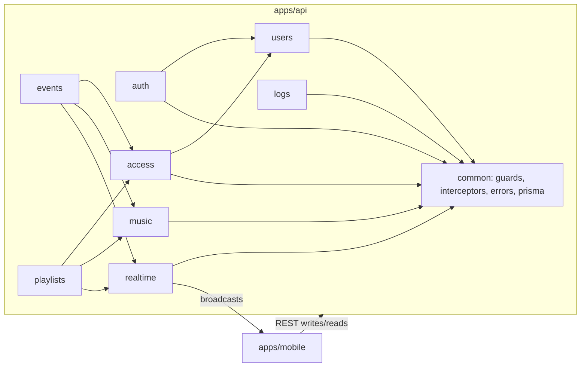
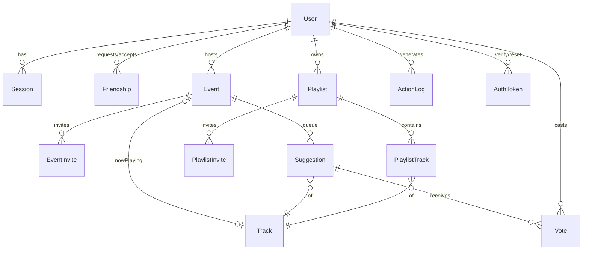
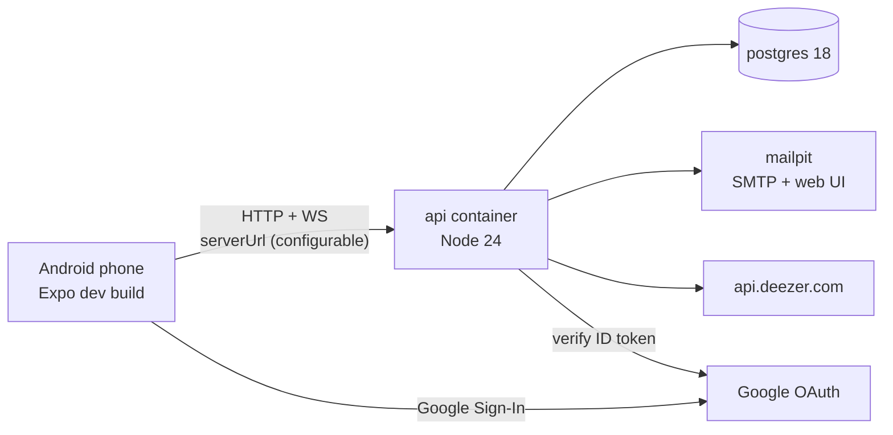

# Architecture Spine — Music Room

## Design Paradigm

**Modular monolith.** There is one NestJS process. Each domain area is a Nest module with three layers: `controller` (HTTP/DTO) → `service` (rules, transactions) → `repository` (Prisma). The mobile app is a **remote control** (V.5): it renders server state and sends intents. It holds no authoritative data.



The diagram is a rule: arrows show the only allowed dependencies. Modules call each other only through **exported services**. Never import another module's repository or Prisma model directly. `realtime` never imports a domain module.

## Invariants & Rules

### AD-1 — REST is the only write path; the socket only broadcasts [ADOPTED]

- **Binds:** FR-9..FR-21, NFR-3
- **Prevents:** two mutation paths with different auth, validation and docs; clients diverging from the DB.
- **Rule:** Every state change is a REST call. After the DB transaction **commits**, the service calls `RealtimeService.emit(room, event, payload)`. Clients join rooms (`event:<id>`, `playlist:<id>`) over Socket.IO and never send mutations through it. On (re)connect, the client refetches the full resource over REST, then applies pushes. Each push carries the resource's new `version`, and the client drops pushes whose `version` is ≤ the one it holds.

### AD-2 — Votes are made concurrency-safe by the database [ADOPTED]

- **Binds:** FR-12, FR-13
- **Prevents:** lost or double votes and drifting counts.
- **Rule:** `Vote(userId, suggestionId)` has a **unique** constraint. Voting is `INSERT … ON CONFLICT DO NOTHING`, and removing a vote is `DELETE`. Each runs in one transaction that then sets `Suggestion.voteCount` with an atomic `± 1`, only when a row was actually inserted or deleted. `Suggestion(eventId, trackId)` is unique: suggesting an existing track becomes a vote. Each Event has a `version` that is incremented on every change to its queue. Queue order is always computed as `ORDER BY voteCount DESC, createdAt ASC` and is never stored.

### AD-3 — Playlist edits are serialized by version (optimistic concurrency) [ADOPTED]

- **Binds:** FR-19, FR-20, FR-21
- **Prevents:** concurrent moves corrupting positions; silent overwrites.
- **Rule:** Each Playlist has an integer `version`. Every add/remove/move request carries `baseVersion`. The service runs `SELECT … FOR UPDATE` on the playlist row and checks `version == baseVersion`. If they differ, it returns **409** `{code:"VERSION_CONFLICT", playlist:<current state>, lastEditor}`. Otherwise it applies the change, rewrites `PlaylistTrack.position` as `0..n-1` contiguous, increments `version`, commits, and broadcasts the full ordered list. `PlaylistTrack(playlistId, trackId)` is unique.

### AD-4 — One access policy per resource, shared by REST and socket

- **Binds:** FR-10, FR-11, FR-14, FR-18, FR-19, NFR-4
- **Prevents:** Events and Playlists, or REST and socket room joins, enforcing visibility and license differently.
- **Rule:** The `access` module exports `canView(user, resource)` and `canAct(user, resource, ctx)`. Every controller uses them through a guard, and the socket `join` handler calls `canView` before joining a room. Visibility is `public | private`. A private resource returns **404** to anyone who can't view it, so it never reveals that it exists. A refused action returns **403** `{code: NOT_INVITED | OUTSIDE_AREA | OUTSIDE_TIME_WINDOW | READ_ONLY}`. Host/Owner always pass.

### AD-5 — The on-site license is checked on the server, in UTC

- **Binds:** FR-9, FR-14
- **Prevents:** the client deciding whether a user is on site; timezone mismatches.
- **Rule:** An `on_site` Event stores `lat`, `lng`, `radiusM`, `startsAt` and `endsAt` as **UTC** instants. Vote and suggest requests on such an Event must include `{lat, lng}`. The server checks the time window, then the haversine distance ≤ `radiusM`. The app only displays times in local time.

### AD-6 — Auth: short-lived JWT plus rotating refresh tokens

- **Binds:** FR-1..FR-5, NFR-5, NFR-6
- **Prevents:** inconsistent session handling between email and Google logins.
- **Rule:** Every login path (email/password or Google) ends at one function, `AuthService.issueSession(user)`. It returns an access JWT (15 min, `sub`, `sid`) and an opaque refresh token. Only the refresh token's hash is stored, in `Session` with a `familyId`. Refreshing rotates the token. Reusing an already-rotated token revokes the whole family. A password reset revokes all of the user's sessions. Google ID tokens are verified on the server (`google-auth-library`), and the app never sends user data from Google. `EmailVerifiedGuard` applies globally, except to `/auth/*` and `/health`. Passwords are hashed with argon2. The app stores tokens in `expo-secure-store`.

### AD-7 — Profile privacy is enforced when the response is built

- **Binds:** FR-6, FR-7, NFR-4
- **Prevents:** an endpoint leaking private fields by returning the raw User row.
- **Rule:** User data leaves the API only through `ProfileView.for(viewer, target)`. It returns `public`, adds `friends` if they are Friends, and adds `private` only if `viewer == target`. Profile sections are stored as separate JSON columns (`publicInfo`, `friendsInfo`, `privateInfo`, `musicPrefs`). Returning a Prisma `User` from a controller is forbidden.

### AD-8 — Deezer is reached only through the backend `music` module

- **Binds:** FR-12, FR-16
- **Prevents:** the app and the backend disagreeing about track identity; expired preview links.
- **Rule:** A Track is identified by its **Deezer ID**. `music` proxies `GET /music/search?q=` (cached for 10 min) and upserts a `Track` row (id, title, artist, artworkUrl) the first time it is used. Preview URLs are **not stored**: the host gets one fresh from `GET /music/tracks/:id/preview` just before playing it. The app never calls Deezer directly.

### AD-9 — Now Playing is advanced by the host, inside a transaction

- **Binds:** FR-16
- **Prevents:** two clients both advancing the queue, or skipping two tracks.
- **Rule:** Only `POST /events/:id/advance {expectedNowPlayingId}` (host only) changes Now Playing. Inside one transaction it checks that `expectedNowPlayingId` still matches (otherwise it does nothing and returns current state), then promotes the top Suggestion, deletes it from the Queue and broadcasts. Audio plays only on the host's device (`expo-audio`).

### AD-10 — Every request is logged by a global interceptor

- **Binds:** NFR-10
- **Prevents:** only some modules logging, or missing device fields.
- **Rule:** The app's HTTP client adds `X-Platform`, `X-Device` and `X-App-Version` to every request. A global Nest interceptor writes one `ActionLog` row per request (userId?, method, route, status, those three fields, timestamp). Modules never write ActionLog themselves.

### AD-11 — One error shape and one config source

- **Binds:** all
- **Prevents:** the app parsing different error formats; secrets scattered through the code.
- **Rule:** A global exception filter turns every error into `{ code: UPPER_SNAKE, message, details? }`. Backend config is read only from env through `ConfigModule` (`.env`, git-ignored, with a committed `.env.example`). App config is limited to `serverUrl`, stored on the device. Every API and socket URL is built from it.

## Consistency Conventions

| Concern | Convention |
| --- | --- |
| Naming | Modules, files and routes in kebab-case (`playlist-tracks.service.ts`); plural REST resources (`/events/:id/suggestions/:sid/vote`); socket events `resource.action` (`queue.updated`, `playlist.updated`, `nowPlaying.changed`, `presence.updated`) |
| IDs & time | DB IDs are UUID v4 strings, except Track (Deezer numeric ID as string). All timestamps are ISO-8601 UTC in JSON |
| Payloads | JSON camelCase. Lists return `{ items, nextCursor? }`. Socket payloads carry the full resource state plus `version`, not diffs |
| Validation | DTOs with `class-validator`, global `ValidationPipe({ whitelist: true, forbidNonWhitelisted: true })` |
| API docs | Every controller and DTO has `@nestjs/swagger` decorators. Swagger UI at `/docs` |
| Rate limits | `@nestjs/throttler` globally (100 requests/min per IP). `/auth/*`: 5 requests/min per IP+email |
| Mobile state | One React Query (or equivalent) cache per resource. Socket pushes write into that cache. Screens never hold their own copy of server state |
| Tests | Each service has unit tests. `test/concurrency/*.e2e-spec.ts` fires N parallel requests for AD-2 and AD-3 |

## Stack

| Name | Version |
| --- | --- |
| Node.js (Docker image) | 24 LTS |
| NestJS (`@nestjs/core`, via `nest new`) | 12.1.x |
| @nestjs/swagger | 12.0.x |
| @nestjs/throttler | 6.7.x |
| @nestjs/websockets + socket.io / socket.io-client | 12.1.x / 4.8.x |
| Prisma (`prisma` + `@prisma/client`) | 7.10.x (not the 8.0 RC) |
| PostgreSQL | 18 |
| google-auth-library | 11.2.x |
| argon2 | 0.45.x |
| nodemailer + Mailpit (docker) | 10.1.x / latest |
| Expo SDK (via `create-expo-app`) + expo-dev-client | 57 |
| react-native-paper | 5.15.x |
| @react-native-google-signin/google-signin | 16.1.x (needs a dev build, not Expo Go) |
| expo-audio / expo-location / expo-secure-store | SDK 57 |
| TypeScript | the version each starter generates |
| k6 | latest |

## Structural Seed

```text
music-room/
  Makefile               # make install | up | test | loadtest
  docker-compose.yml     # api, postgres, mailpit
  .env.example
  apps/
    api/                 # NestJS
      src/{common,auth,users,access,events,playlists,music,realtime,logs}/
      prisma/schema.prisma
      test/concurrency/
    mobile/              # Expo app (expo-router)
      app/(auth)/ app/(tabs)/{discover,events,playlists,profile}/
      src/api/           # http client (adds X-* headers), socket client, query hooks
  loadtest/              # k6 scripts
  docs/                  # SECURITY.md, LOADTEST.md, AI_USAGE.md
  .github/workflows/ci.yml
```





**Environments:** there is only **local/demo**: `docker compose up` on the developer's machine, with the phone on the same LAN pointing `serverUrl` at the machine's IP. CI (GitHub Actions) runs the API tests against a Postgres service container. Load tests run against the same compose stack, and the host's specs are recorded in `docs/LOADTEST.md`.

## Capability → Architecture Map

| Capability / Area | Lives in | Governed by |
| --- | --- | --- |
| FR-1..5 Accounts | `auth`, `users`, mailpit | AD-6, AD-11 |
| FR-6..8 Profile, friends | `users` | AD-7 |
| FR-9..16 Track Vote | `events`, `music`, `realtime` | AD-1, AD-2, AD-4, AD-5, AD-8, AD-9 |
| FR-17..21 Playlist Editor | `playlists`, `music`, `realtime` | AD-1, AD-3, AD-4, AD-8 |
| FR-22, 23 Server URL, remote control | `apps/mobile/src/api` | AD-11, paradigm |
| NFR-1..3 API & docs | `common`, every controller | Conventions, AD-1 |
| NFR-4..9 Security | `common` guards, `auth`, `access` | AD-4, AD-6, AD-7, AD-11 |
| NFR-10 Logging | `logs` interceptor | AD-10 |
| NFR-11..12 Ramp-up | `loadtest/`, `docs/LOADTEST.md` | Structural Seed |
| NFR-13..15 Delivery | Makefile, compose, CI | AD-11, Structural Seed |

## Deferred

- **Horizontal scaling** (Socket.IO Redis adapter, several API instances): one instance is enough for the measured load. AD-1, AD-2 and AD-3 already keep the DB as the single source of truth, so this can be added later without changing any rule.
- **Production hosting / TLS**: the demo runs on local compose. HTTPS would be a reverse proxy in front of `api`, with no code impact.
- **Real email delivery**: nodemailer is SMTP-agnostic, so it's just a matter of changing the SMTP env vars.
- **Presence storage**: kept in memory in `realtime` (lost on restart, which is acceptable).
- **Mobile screen and component structure**: owned by `EXPERIENCE.md` and the code.
- **Exact column list per entity**: the code (`schema.prisma`) owns it. Only the constraints named in the ADs are binding.
